<p align="center">
  <a href="https://circuitlab.app">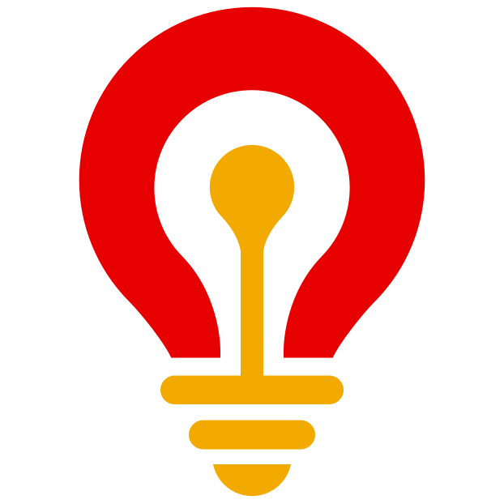</a>
</p>

<h1 align="center">مختبر الدوائر</h1>

<p align="center" dir="rtl">
  <b>محاكٍ ثلاثي الأبعاد للدوائر الكهربائية للأطفال، يعمل داخل المتصفح.</b><br>
  اسحب القطع إلى اللوحة، وصِلها بالأسلاك، وشاهد المصابيح تضيء والمحركات تدور والشاشات تنبض بالحياة.<br>
  ثم قل للوحة الذكاء الاصطناعي ماذا تفعل، بكلماتك أنت.
</p>

<p align="center">
  <a href="https://circuitlab.app"></a>
  <a href="https://github.com/circuitlab-app/circuitlab"></a>
</p>

<p align="center" dir="rtl">
  <b>111</b> قطعة · <b>213</b> مشروعًا جاهزًا · <b>69</b> أداة ورشة · <b>15</b> مهمة · <b>3</b> لغات · مجاني ومفتوح المصدر
</p>

<p align="center">
  <a href="README.md">English</a> · <a href="README.fa.md">فارسی</a> · <b>العربية</b>
</p>

<p align="center">
  <a href="https://circuitlab.app">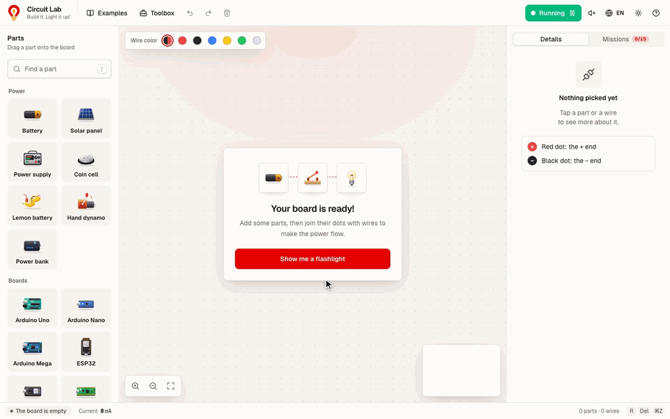</a>
  <br>
  <sub dir="rtl">ابنِ دائرة ثم اطلب من لوحة الذكاء الاصطناعي: «اجعل الضوء يخفت ويشتد ببطء». (حُذف وقت تفكير النموذج المحلي من المقطع.)</sub>
</p>

<div dir="rtl">

## لماذا يحبّه الأطفال

<table dir="rtl">
  <tr>
    <td width="50%" valign="top">
      <a href="docs/images/examples.jpg">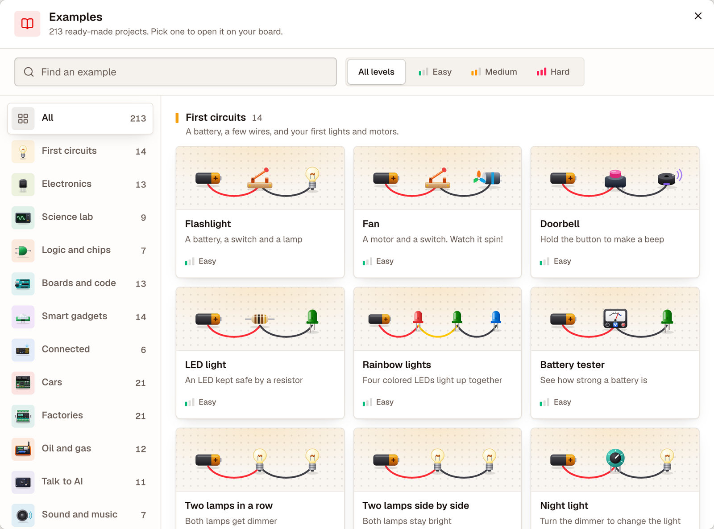</a>
      <b>213 مشروعًا جاهزًا</b><br>
      سبعة عشر رفًّا، من أول مصباح يدوي إلى السيارات والمصانع وآبار النفط والأجهزة المنزلية. اختر واحدًا فيُفتح على اللوحة جاهزًا للعب.
    </td>
    <td width="50%" valign="top">
      <a href="docs/images/dark.jpg">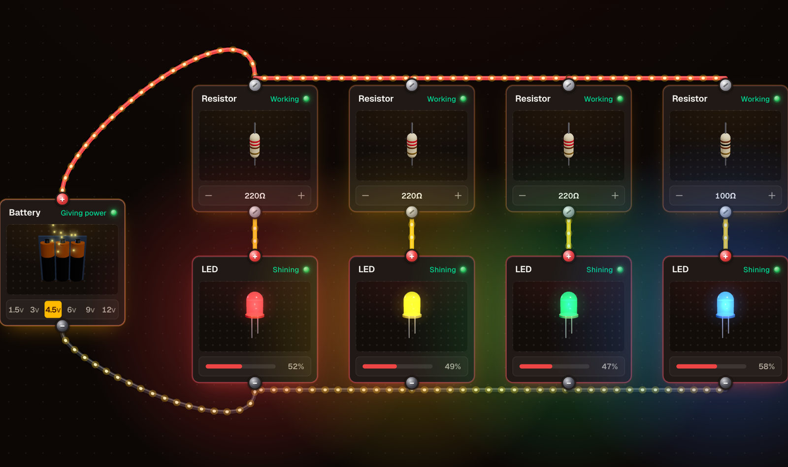</a>
      <b>أضواء تتوهّج حقًا</b><br>
      كل قطعة نموذج ثلاثي الأبعاد حيّ. في الوضع الداكن تصبح اللوحة غرفة مظلمة تضيئها الليدات والمصابيح والشاشات.
    </td>
  </tr>
  <tr>
    <td width="50%" valign="top">
      <a href="docs/images/plc.jpg">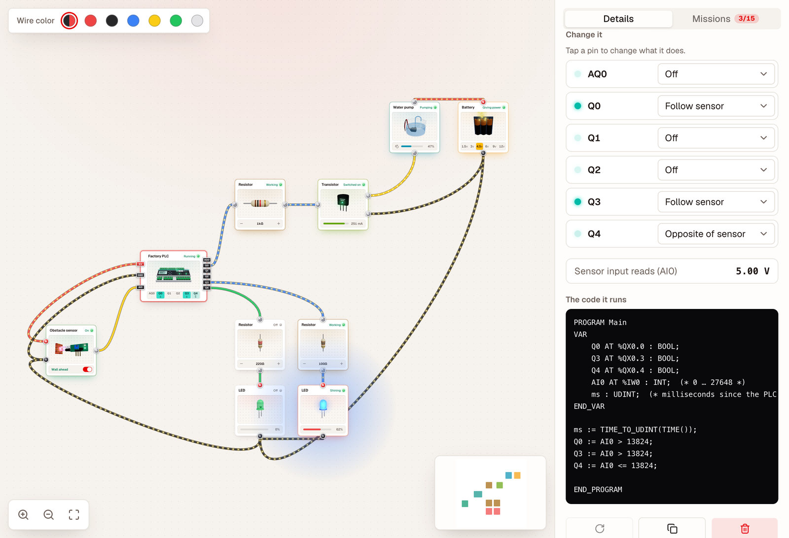</a>
      <b>لوحات حقيقية وشيفرة حقيقية</b><br>
      أردوينو وESP32 وراسبيري باي وmicro:bit وشرائح AVR وحاسوب محرك السيارة وPLC المصنع. كل واحدة تعرض الشيفرة الحقيقية لما اخترته: Arduino C++ أو AVR C أو MicroPython أو Python أو Structured Text الخاصة بـPLC.
    </td>
    <td width="50%" valign="top">
      <a href="docs/images/persian.jpg">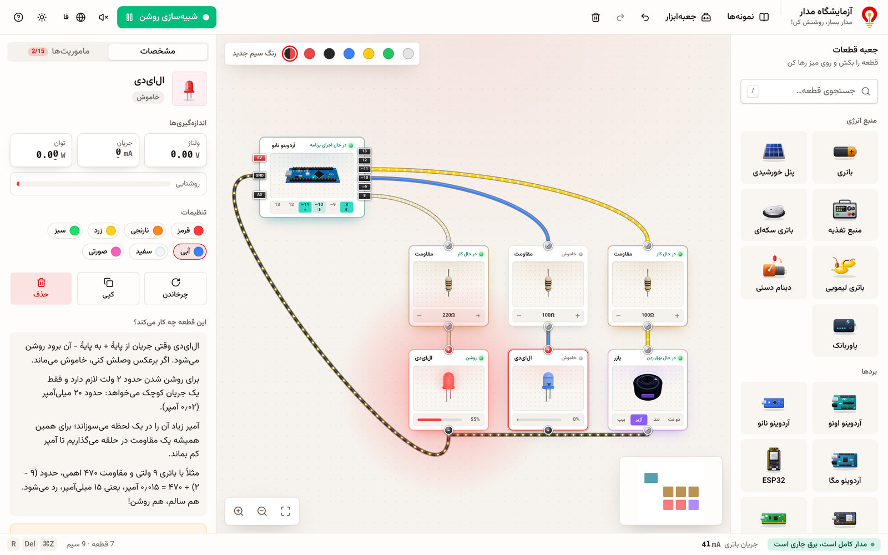</a>
      <b>العربية وفارسی وEnglish</b><br>
      كل كلمة باللغات الثلاث. بالعربية والفارسية ينقلب التطبيق كله من اليمين إلى اليسار، مع خط مصمَّم لكل كتابة.
    </td>
  </tr>
</table>

## الأدوات

<table dir="rtl">
  <tr>
    <td width="50%" valign="top">
      <a href="docs/images/board.jpg">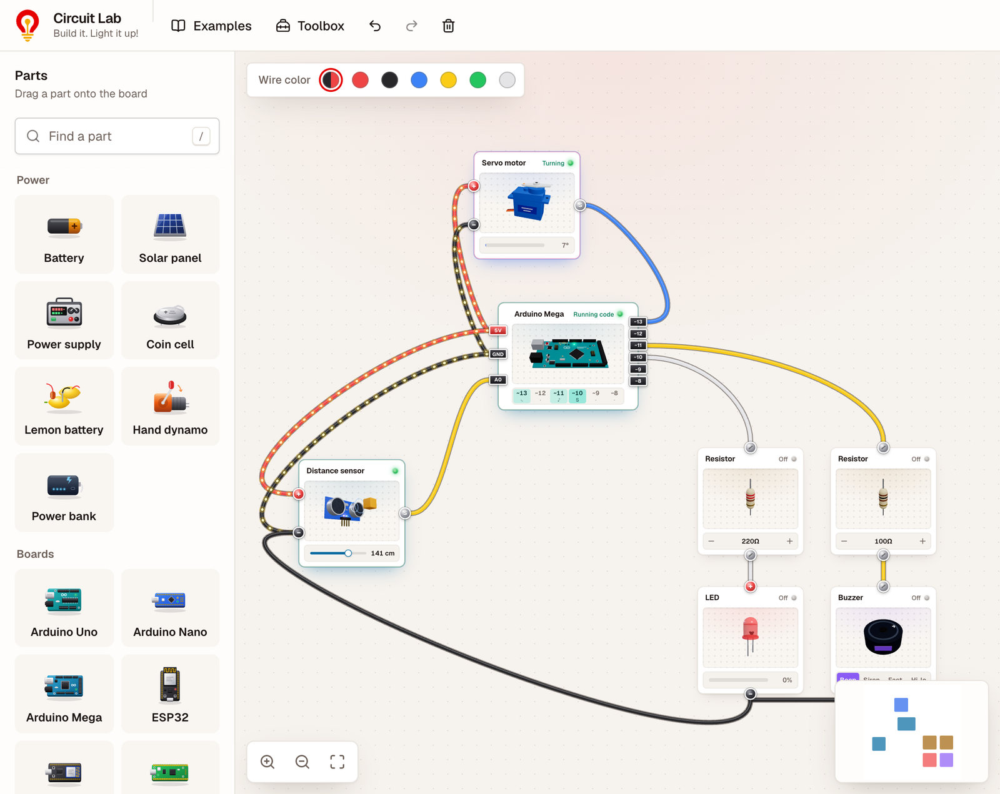</a>
      <h3>🧩 صندوق القطع واللوحة</h3>
      111 قطعة في عشر مجموعات: الطاقة، واللوحات، والمفاتيح، والقطع الإلكترونية، والشرائح، والضوء والحركة، والشاشات، والحسّاسات، والشبكات، وأجهزة القياس. اسحب قطعة إلى اللوحة وصِل النقطتين الحمراء <b>+</b> والسوداء <b>−</b> بالأسلاك. يظهر التيار نقاطًا تجري على الأسلاك.
    </td>
    <td width="50%" valign="top">
      <a href="docs/images/ai.jpg">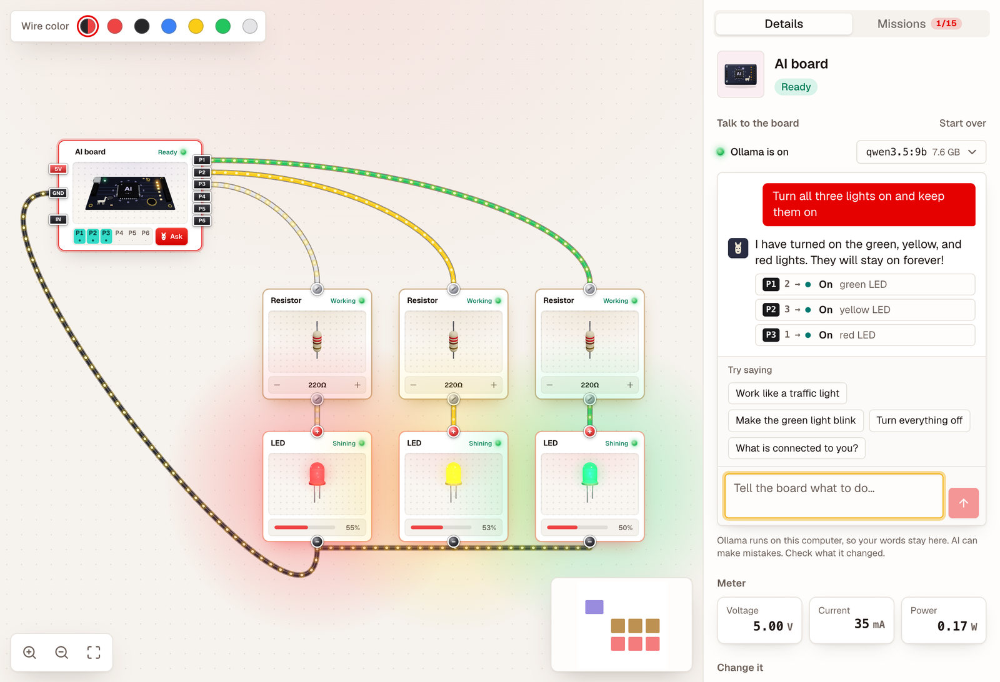</a>
      <h3>🦙 لوحة الذكاء الاصطناعي</h3>
      لوحة تتحدث إليها. صِل بها الأضواء والمحركات والطنّانات، واضغط <b>اسأل</b> واكتب ما يجب أن تفعله. تختار برنامجًا لكل منفذ وتعرض بدقة أي المنافذ تغيّرت. يعمل النموذج على حاسوبك نفسه عبر Ollama.
    </td>
  </tr>
  <tr>
    <td width="50%" valign="top">
      <a href="docs/images/scope.jpg">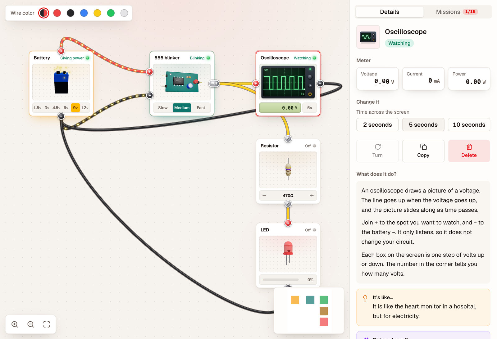</a>
      <h3>📈 أجهزة القياس وراسم الإشارة</h3>
      ملتيميتر وفولتميتر وأميتر ومجسّ منطقي وراسم إشارة يرسم الجهد خطًّا متحركًا. وتعرض تفاصيل كل قطعة الفولت والأمبير والواط الحيّة.
    </td>
    <td width="50%" valign="top">
      <a href="docs/images/screens.jpg">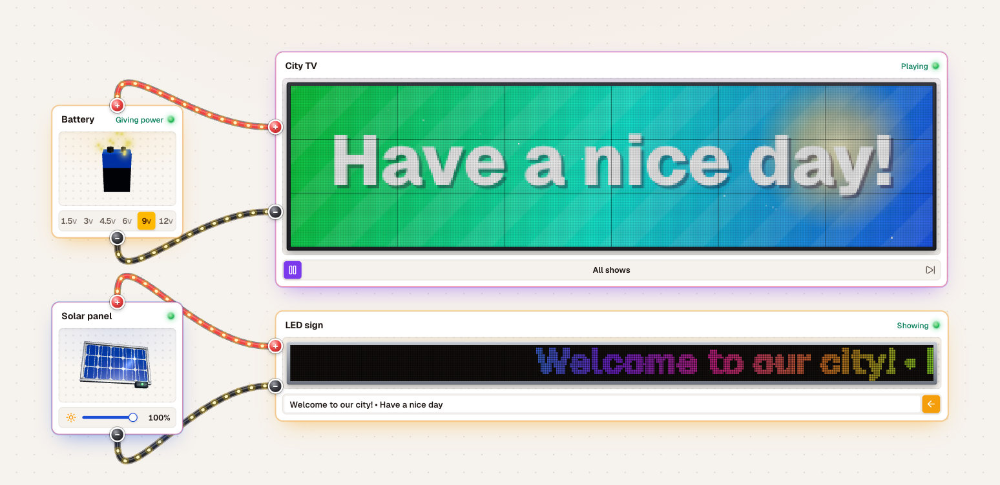</a>
      <h3>📺 الشاشات وجدران الليد</h3>
      شاشات أرقام، وLCD وOLED وشاشات ملوّنة، وجدران ليد بأي حجم: لافتات المتاجر، ولوحة المطار، وتلفاز المدينة الذي يعرض صورك ومقاطعك.
    </td>
  </tr>
  <tr>
    <td width="50%" valign="top">
      <a href="docs/images/code.jpg">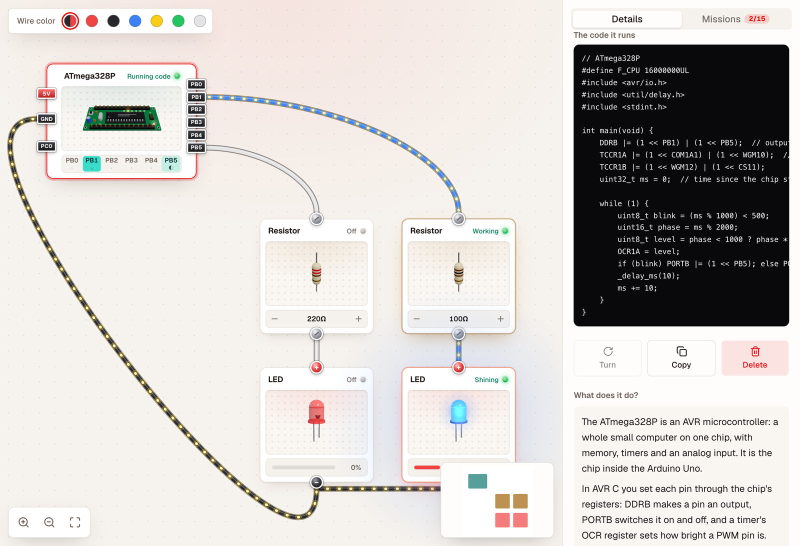</a>
      <h3>💻 اللوحات والشيفرة</h3>
      اختر ما يفعله كل منفذ (تشغيل، وميض، بالتناوب، تدرّج، اتباع حسّاس) فتكتب اللوحة البرنامج الحقيقي له، حتى شيفرة AVR C على مستوى السجلات لشرائح ATmega وATtiny.
    </td>
    <td width="50%" valign="top">
      <a href="docs/images/iot.jpg">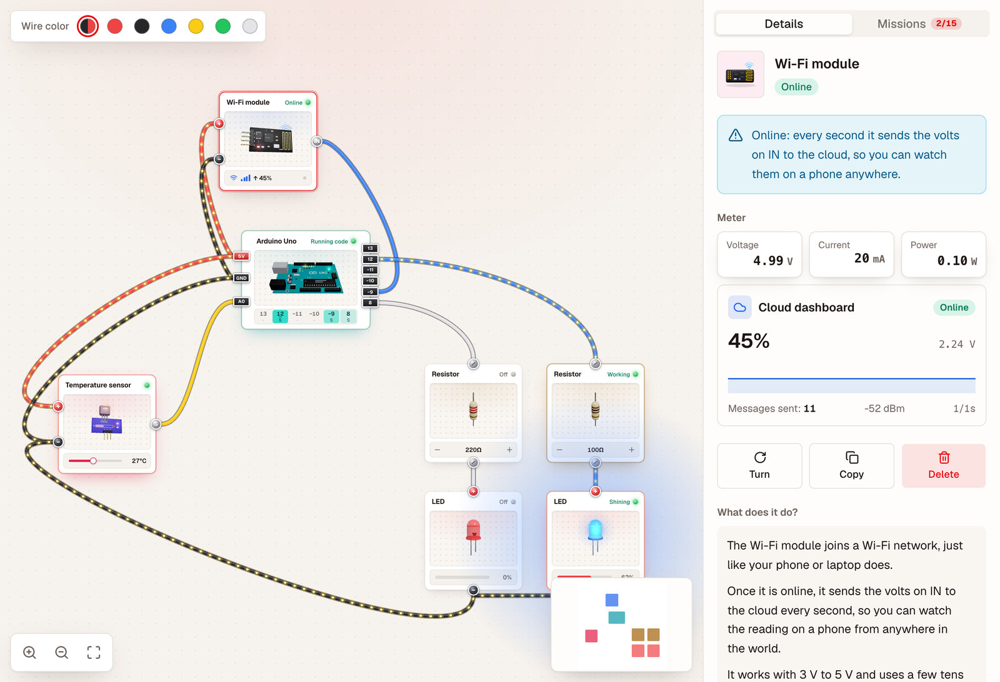</a>
      <h3>📡 الرسائل والشبكات</h3>
      وحدات SMS وواي فاي وبلوتوث وLoRa وGPS، وناقل CAN في السيارات وRS-485 / Modbus في المصانع. تعرض لوحة التفاصيل ما يصل: الرسائل على الهاتف، ولوحة السحابة، ورسالة CAN أو سجل Modbus.
    </td>
  </tr>
  <tr>
    <td width="50%" valign="top">
      <a href="docs/images/lesson.jpg">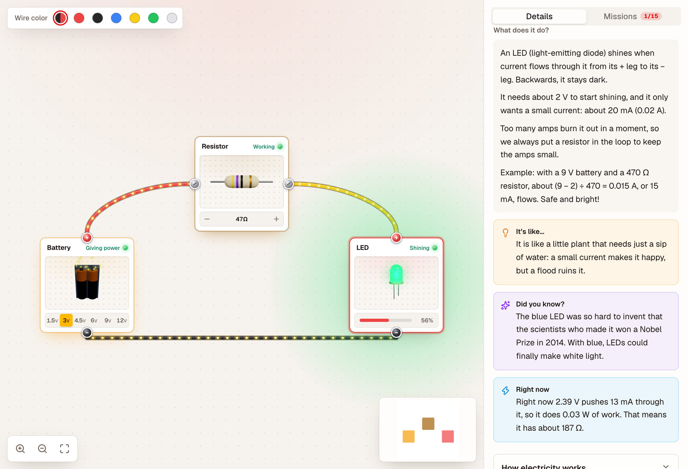</a>
      <h3>📖 الدروس</h3>
      انقر أي قطعة لتعرف عملها بكلمات بسيطة، مع «مثل…» و«هل تعلم؟» وقسم «الآن» الذي يشرح بالأرقام الحيّة من اللوحة. والمقاومات تعلّم قراءة ألوانها.
    </td>
    <td width="50%" valign="top">
      <a href="docs/images/missions.jpg">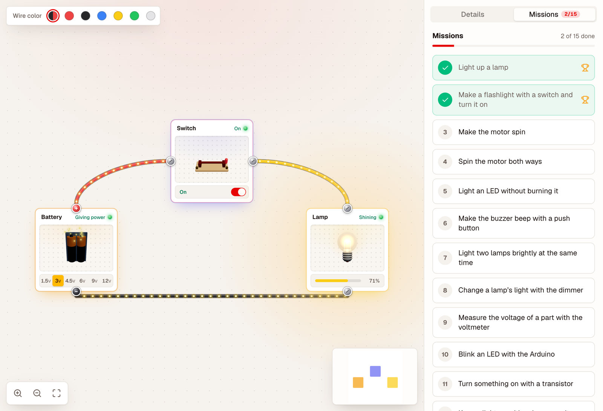</a>
      <h3>🏆 المهام</h3>
      خمسة عشر تحديًا، من «أضئ مصباحًا» إلى «اجعل ليدًا يومض بالأردوينو». تُنجَز كل مهمة تلقائيًا، مع احتفال بالقصاصات الملوّنة، عندما تؤدي الدائرة على اللوحة المطلوب.
    </td>
  </tr>
  <tr>
    <td width="50%" valign="top">
      <a href="docs/images/toolbox.jpg">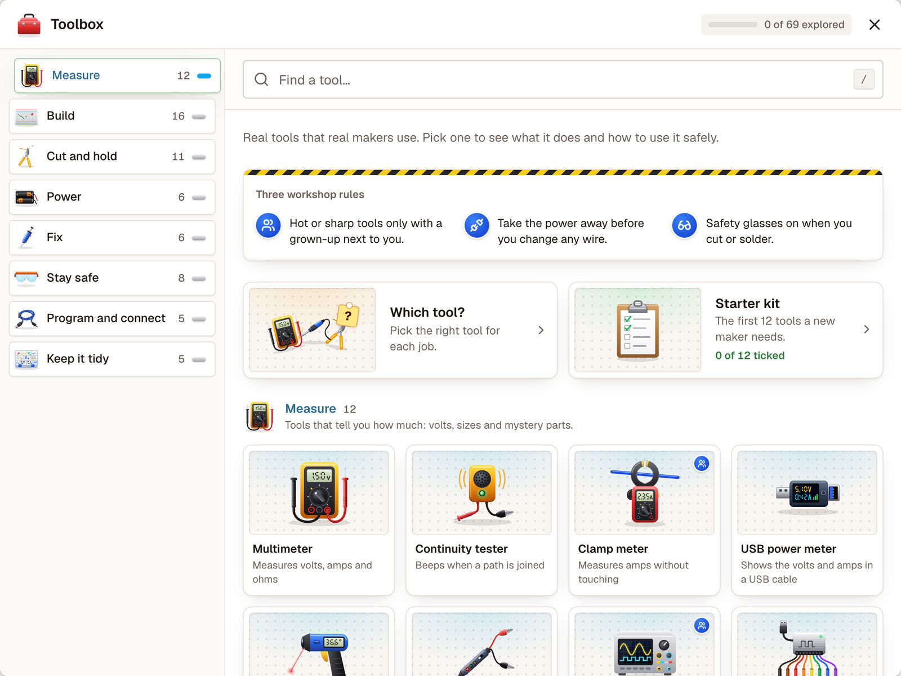</a>
      <h3>🧰 صندوق العُدّة</h3>
      69 أداة حقيقية من الورشة في ثماني مجموعات: القياس، والبناء، والقطع والإمساك، والطاقة، والإصلاح، والسلامة، والبرمجة والتوصيل، والترتيب. إضافةً إلى اختبار «أيّ أداة؟» وقائمة عُدّة البداية.
    </td>
    <td width="50%" valign="top">
      <a href="docs/images/tool.jpg">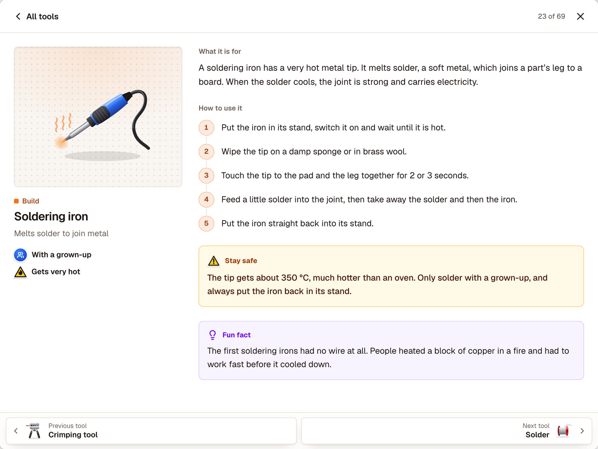</a>
      <h3>🔧 صفحة لكل أداة</h3>
      لكل أداة رسم، وما فائدتها، وكيف تستعملها خطوة بخطوة، ونصيحة أمان ومعلومة طريفة. وإذا كان للأداة قطعة مماثلة على اللوحة، تجرّبها بزر واحد.
    </td>
  </tr>
</table>

<details>
<summary><b>كل ما في التطبيق</b> (كل القطع واللوحات ورفوف الأمثلة)</summary>

- **مصادر الطاقة:** بطاريات من 1.5 إلى 12 فولت، ولوح شمسي، ومزوّد طاقة مخبري، وبطارية ليمون (ثلاث ليمونات تضيء ليدًا أحمر إضاءة خافتة)، وبطارية زر، ودينامو يدوي، وبنك طاقة.
- **اللوحات:** أردوينو أونو ونانو وميغا، وESP32، وESP8266، وراسبيري باي بيكو، وmicro:bit، وراسبيري باي، وشرائح AVR وهي ATmega328P وATmega32 (ATmega16) وATtiny85 بشيفرة AVR C على مستوى السجلات، والحبة الزرقاء STM32. يمكن لكل منفذ أن يكون مشغّلًا أو مطفأً أو وامضًا أو بالتناوب أو متدرّجًا أو تابعًا لحسّاس، وتعرض اللوحة الشيفرة الحقيقية لما اخترته.
- **لوحات من العالم الحقيقي:** حاسوب محرك السيارة (ECU)، وPLC المصنع الذي يعرض برنامجه بلغة Structured Text، وRTU بئر النفط، إضافةً إلى مقياس ضغط صناعي.
- **الرسائل والشبكات:** وحدات SMS وواي فاي وبلوتوث وLoRa، وGPS، وناقل CAN في السيارات وRS-485 / Modbus في المصانع.
- **لوحة الذكاء الاصطناعي:** لوحة تتحدث إليها: «اجعل الضوء الأحمر يومض»، «أشعل المصباح عندما يحلّ الظلام».
- **المفاتيح والمقابض:** مفتاح، وزر ضغط، ومفتاح درج، ومفتاح دقيق، ومخفّت إضاءة، ومقبض (مقاوم متغيّر)، وعصا تحكم، ومُرحِّل.
- **القطع الإلكترونية:** مقاومة (مع درس قراءة الألوان)، ومكثّف، وثنائي (دايود)، ودايود زينر، وترانزستورات، وموسفت، ومقرن ضوئي، وفيوز، ومنظّم جهد.
- **الشرائح والمنطق:** بوابات NOT وAND وOR وXOR وNAND وNOR مع جدول صواب حيّ، وذاكرة (لاتش)، وعدّاد أضواء متلاحقة، ومقارن، ومومض 555، ومشغّل محرك.
- **الضوء والصوت والحركة:** مصباح، وليد، وليد RGB، ومحرك، ومحرك اهتزاز، وطنّان (صفير أو صفارة شرطة حقيقية)، ومكبّر صوت، وجرس كهربائي، وعنصر تسخين، ومغناطيس كهربائي، وملف لولبي، ومحرك سيرفو، وليزر، وليد تحت أحمر، وإشارة مرور، ومنارة تحذير دوّارة، وشريط ليدات، ومروحة، ومضخة ماء بماء يتحرك فعلًا.
- **الحسّاسات:** الضوء، والحرارة، والميل، والمغناطيس، والمسافة، والحركة، والصوت، والدخان، والتربة، واللمس، واللهب، والمطر، ومستوى الماء، والرطوبة، والعوائق، والخط، والضغط، ونبض القلب، والطَّرق.
- **الشاشات:** شاشات أرقام، وشاشات نصية وملوّنة، ومصفوفات ليد، وجدران ليد بأي حجم.
- **أجهزة القياس:** ملتيميتر، ومجسّ منطقي، وفولتميتر، وأميتر، وراسم إشارة (أوسيلوسكوب).
- **أخطاء آمنة:** الجهد الزائد يحرق المصباح، والليد بلا مقاومة يحترق، والسلك الواصل مباشرة بين طرفي البطارية يسبّب دائرة قصر، والفيوز يحترق ليحمي بقية الدائرة. لا شيء ينكسر أو يسخن فعلًا، لذا يستطيع الأطفال تجربة أي شيء، وأن يخطئوا ويفهموا السبب.
- **213 مشروعًا جاهزًا** على سبعة عشر رفًّا، منها 21 للسيارات و21 للمصانع و12 للنفط والغاز و25 جهازًا منزليًا تُظهر كيف تعمل من الداخل (الغسالة والثلاجة والمكنسة الكهربائية والعصّارة والخلّاط والمحمصة والمكواة والسماور …) و11 تتحدث إليها، مع بحث وتصفية سهل / متوسط / صعب.

</details>

## ثلاث لغات، كل كلمة

بُني مختبر الدوائر من الأساس **بالعربية والفارسية والإنجليزية**، فيحصل الطفل في مسقط أو طهران أو لندن على التطبيق نفسه بلغته.

- **كل شيء باللغات الثلاث:** اللوحة، وجميع القطع الـ111 ودروسها، و213 مشروعًا جاهزًا، و15 مهمة، وصندوق العُدّة واختباره، وكل نصيحة وتحذير.
- **من اليمين إلى اليسار حقًا:** بالعربية والفارسية ينقلب التطبيق كله كالمرآة، من اللوحات والقوائم إلى المنزلقات وأسهم لوحة المفاتيح، وتبقى المعادلات مثل V = A × Ω مقروءة بشكل صحيح.
- **خط مصمَّم لكل كتابة،** وأرقام فارسية حيث يتوقعها الأطفال الناطقون بالفارسية.
- **بحث يفهمك:** الشكلان العربي والفارسي للحرف نفسه (ي / ی، ك / ک) يصلان إلى النتيجة نفسها.
- **ذكاء اصطناعي يتكلم لغتك:** تفهم لوحة الذكاء الاصطناعي الطلبات باللغات الثلاث، وتجيب بلغة التطبيق.

## تحدّث مع لوحة الذكاء الاصطناعي

تستخدم لوحة الذكاء الاصطناعي نموذجًا لغويًا يعمل على حاسوبك نفسه عبر [Ollama](https://ollama.com). بلا حساب وبلا سحابة: كلمات الطفل تبقى في البيت.

1. ثبّت Ollama من [ollama.com](https://ollama.com) وافتحه.
2. نزّل نموذجًا مرة واحدة، مثلًا `ollama pull gemma3:4b`.
3. في مختبر الدوائر، أضف لوحة ذكاء اصطناعي (أو افتح مثالًا من رف **الذكاء الاصطناعي**) واضغط **اسأل** على بطاقتها.

إذا نقص شيء، تعرض لوحة الذكاء الاصطناعي خطوات بسيطة لإصلاحه.

## في كل مكان

- **عبر الإنترنت** على [circuitlab.app](https://circuitlab.app)، على الحاسوب أو الجهاز اللوحي أو الهاتف.
- **ثبّته كتطبيق** من قائمة المتصفح («تثبيت» أو «إضافة إلى الشاشة الرئيسية»).
- **يعمل دون إنترنت** بعد الزيارة الأولى، وتُحفظ لوحتك تلقائيًا.

## شغّله على حاسوبك

تحتاج إلى [Node.js](https://nodejs.org) الإصدار 22.12 أو أحدث.

</div>

```bash
git clone https://github.com/circuitlab-app/circuitlab.git
cd circuitlab
npm install
npm run dev      # http://localhost:5173
```

<div dir="rtl">

| الأمر | ماذا يفعل |
| --- | --- |
| `npm run dev` | يشغّل التطبيق مع إعادة التحميل التلقائي |
| `npm test` | يشغّل اختبارات الوحدات (Vitest) |
| `npm run lint` | يفحص الشيفرة بأداة oxlint |
| `npm run build` | يتحقق من الأنواع ويبني الموقع في `dist/` |

مبني بـReact 19 وTypeScript وVite وReact Flow وthree.js (React Three Fiber) وTailwind CSS وshadcn/ui وZustand. محلّل الدائرة محرّك صغير للتحليل العُقدي في `src/circuit/solver.ts`. يشرح [docs/DEVELOPMENT.md](docs/DEVELOPMENT.md) (بالإنجليزية) كيف تعمل المحاكاة والنماذج ثلاثية الأبعاد ولوحة الذكاء الاصطناعي.

## المساهمة

الأفكار وتقارير الأخطاء وطلبات الدمج (Pull Requests) مرحَّب بها.

- **وجدت خطأً أو لديك فكرة؟** [افتح Issue](https://github.com/circuitlab-app/circuitlab/issues)، ومعها لقطة شاشة إن أمكن.
- **تريد إضافة شيء؟** يعرض قسم [Adding things](docs/DEVELOPMENT.md#adding-things) خطوات إضافة قطعة أو لغة جديدة. والمشاريع الجاهزة موجودة في `src/circuit/presets.ts`.
- **قبل طلب الدمج** شغّل `npm test` و`npm run lint` و`npm run build`، وأضف أي كلمات جديدة إلى القواميس الثلاثة في `src/i18n/` (الإنجليزية والفارسية والعربية).

إذا ساعد مختبر الدوائر طفلًا تعرفه، فنجمة ⭐ على GitHub تساعد الآخرين على اكتشافه.

## من نحن

مختبر الدوائر من منتجات **SBC** · [sbc.om](https://sbc.om) · منشور بموجب [رخصة MIT](LICENSE).

</div>
