<p align="center">
  <a href="https://circuitlab.app">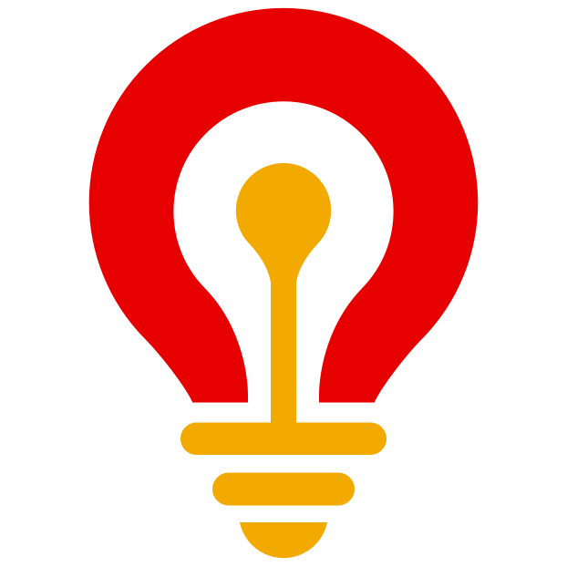</a>
</p>

<h1 align="center">آزمایشگاه مدار</h1>

<p align="center" dir="rtl">
  <b>شبیه‌ساز سه‌بعدی مدار برای بچه‌ها، درست داخل مرورگر.</b><br>
  قطعه‌ها را روی میز بکش، با سیم به هم وصلشان کن و ببین لامپ‌ها روشن می‌شوند، موتورها می‌چرخند و نمایشگرها جان می‌گیرند.<br>
  بعد به برد هوش مصنوعی با زبان خودت بگو چه کار کند.
</p>

<p align="center">
  <a href="https://circuitlab.app"></a>
  <a href="https://github.com/circuitlab-app/circuitlab"></a>
</p>

<p align="center" dir="rtl">
  <b>۱۱۱</b> قطعه · <b>۲۱۳</b> پروژهٔ نمونه · <b>۶۹</b> ابزار کارگاه · <b>۱۵</b> ماموریت · <b>۳</b> زبان · رایگان و متن‌باز
</p>

<p align="center">
  <a href="README.md">English</a> · <b>فارسی</b> · <a href="README.ar.md">العربية</a>
</p>

<p align="center">
  <a href="https://circuitlab.app">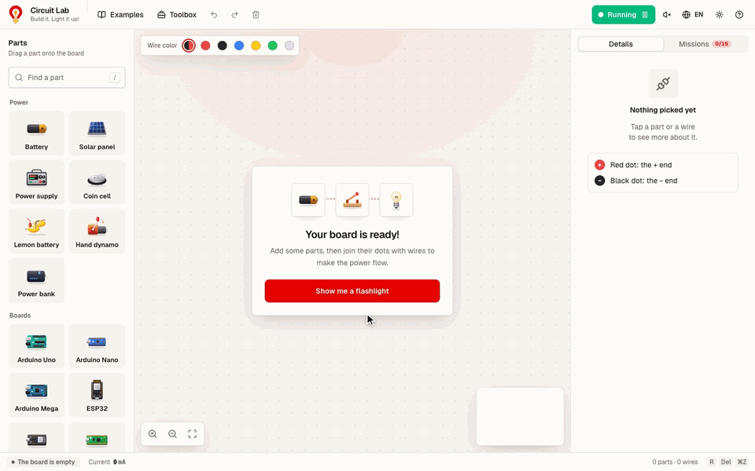</a>
  <br>
  <sub dir="rtl">یک مدار بساز و از برد هوش مصنوعی بخواه: «چراغ را آرام کم‌وزیاد کن.» (زمان فکر کردن مدل محلی از فیلم حذف شده است.)</sub>
</p>

<div dir="rtl">

## چرا بچه‌ها عاشقش می‌شوند

<table dir="rtl">
  <tr>
    <td width="50%" valign="top">
      <a href="docs/images/examples.jpg">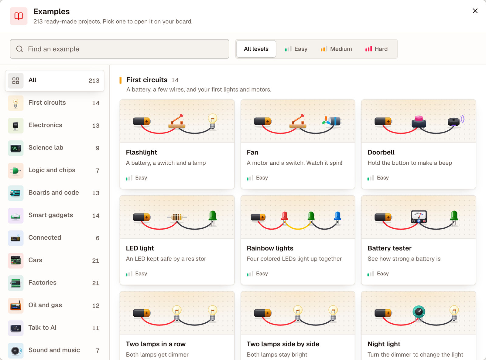</a>
      <b>۲۱۳ پروژهٔ آماده</b><br>
      هفده قفسه، از اولین چراغ‌قوه تا خودرو، کارخانه، چاه نفت و وسایل خانه. یکی را انتخاب کن تا آماده روی میز باز شود.
    </td>
    <td width="50%" valign="top">
      <a href="docs/images/dark.jpg">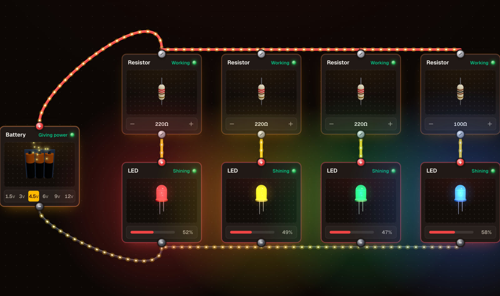</a>
      <b>چراغ‌هایی که واقعاً می‌درخشند</b><br>
      هر قطعه یک مدل سه‌بعدی زنده است. در حالت تیره میز کار مثل اتاقی تاریک می‌شود که ال‌ای‌دی‌ها، لامپ‌ها و نمایشگرها روشنش می‌کنند.
    </td>
  </tr>
  <tr>
    <td width="50%" valign="top">
      <a href="docs/images/plc.jpg">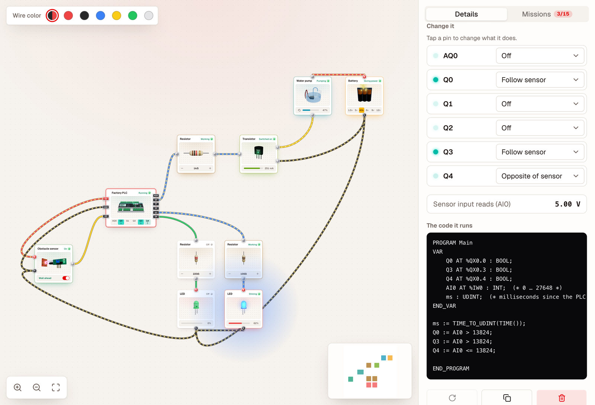</a>
      <b>بردهای واقعی، کد واقعی</b><br>
      آردوینو، ESP32، رزبری پای، میکروبیت، تراشه‌های AVR، کامپیوتر موتور خودرو و PLC کارخانه. هر کدام کد واقعیِ همان چیزی را که انتخاب کرده‌ای نشان می‌دهد: Arduino C++، AVR C، MicroPython، Python یا Structured Text مخصوص PLC.
    </td>
    <td width="50%" valign="top">
      <a href="docs/images/persian.jpg">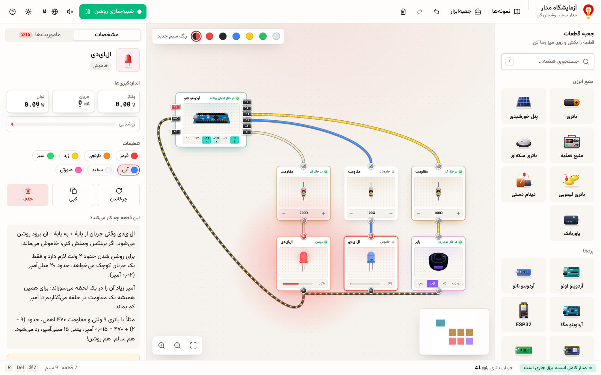</a>
      <b>فارسی، العربية و English</b><br>
      تک‌تک کلمه‌ها به هر سه زبان. در فارسی و عربی کل برنامه راست‌به‌چپ می‌شود و هر خط فونت مخصوص خودش را دارد.
    </td>
  </tr>
</table>

## ابزارها

<table dir="rtl">
  <tr>
    <td width="50%" valign="top">
      <a href="docs/images/board.jpg">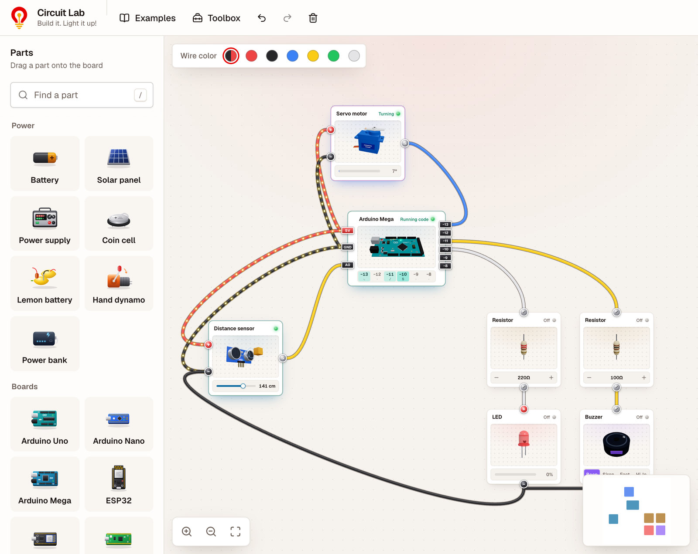</a>
      <h3>🧩 جعبهٔ قطعات و میز کار</h3>
      ۱۱۱ قطعه در ده دسته: منبع انرژی، بردها، کلیدها، قطعات الکترونیکی، تراشه‌ها، نور و حرکت، نمایشگرها، سنسورها، شبکه‌ها و وسایل اندازه‌گیری. یک قطعه را روی میز بکش و نقطه‌های قرمز <b>+</b> و سیاه <b>−</b> را با سیم به هم وصل کن. جریان برق به شکل نقطه‌هایی دیده می‌شود که روی سیم‌ها می‌دوند.
    </td>
    <td width="50%" valign="top">
      <a href="docs/images/ai.jpg">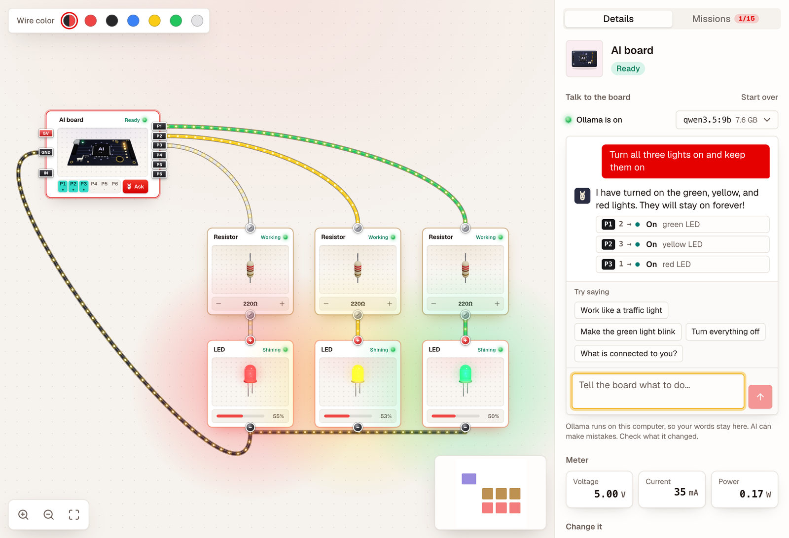</a>
      <h3>🦙 برد هوش مصنوعی</h3>
      بردی که با آن حرف می‌زنی. چراغ، موتور و بازر را به آن وصل کن، <b>بپرس</b> را بزن و بنویس چه کار کنند. برد برای هر پایه برنامه‌ای انتخاب می‌کند و دقیق نشان می‌دهد کدام پایه‌ها عوض شدند. مدل با Ollama روی کامپیوتر خودت اجرا می‌شود.
    </td>
  </tr>
  <tr>
    <td width="50%" valign="top">
      <a href="docs/images/scope.jpg">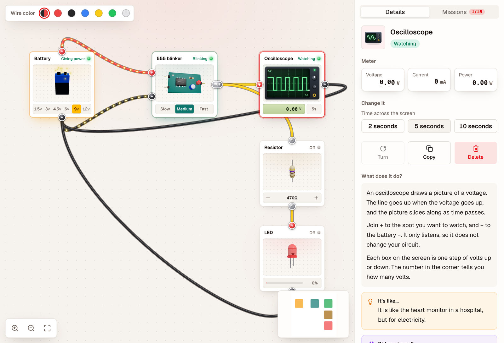</a>
      <h3>📈 وسایل اندازه‌گیری و اسیلوسکوپ</h3>
      مولتی‌متر، ولت‌متر، آمپرمتر، لاجیک‌پروب و اسیلوسکوپی که ولتاژ را به شکل خطی متحرک رسم می‌کند. مشخصات هر قطعه هم ولت، آمپر و وات زنده‌اش را نشان می‌دهد.
    </td>
    <td width="50%" valign="top">
      <a href="docs/images/screens.jpg">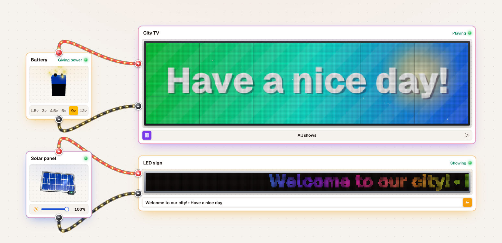</a>
      <h3>📺 نمایشگرها و دیوارهای ال‌ای‌دی</h3>
      نمایشگر عددی، LCD، OLED، صفحهٔ رنگی و دیوار ال‌ای‌دی در هر اندازه: تابلوی مغازه، تابلوی فرودگاه و تلویزیون شهری که عکس‌ها و فیلم‌های خودت را پخش می‌کند.
    </td>
  </tr>
  <tr>
    <td width="50%" valign="top">
      <a href="docs/images/code.jpg">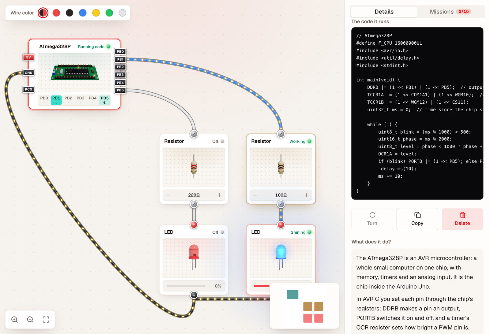</a>
      <h3>💻 بردها و کد</h3>
      انتخاب کن هر پایه چه کار کند (روشن، چشمک‌زن، نوبتی، کم‌وزیاد، دنبال سنسور) تا برد برنامهٔ واقعی‌اش را بنویسد؛ حتی کد AVR C در سطح رجیستر برای تراشه‌های ATmega و ATtiny.
    </td>
    <td width="50%" valign="top">
      <a href="docs/images/iot.jpg">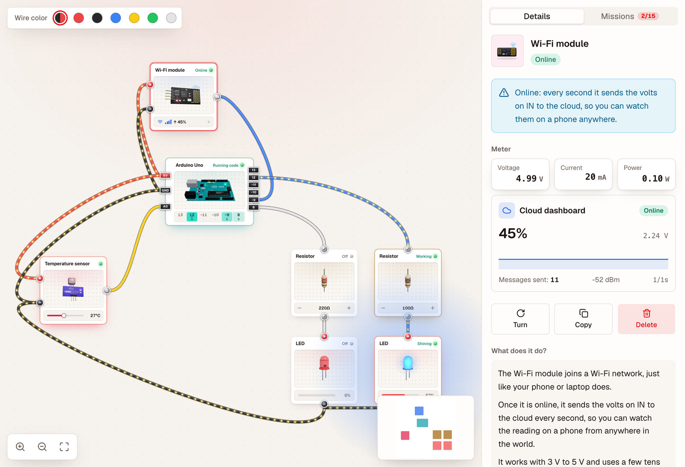</a>
      <h3>📡 پیام و شبکه</h3>
      ماژول‌های پیامک، وای‌فای، بلوتوث، LoRa و GPS، CAN باس خودرو و RS-485 / مادباس کارخانه. پنل مشخصات نشان می‌دهد چه می‌رسد: پیامک‌های روی گوشی، داشبورد ابری، پیام CAN یا رجیستر مادباس.
    </td>
  </tr>
  <tr>
    <td width="50%" valign="top">
      <a href="docs/images/lesson.jpg">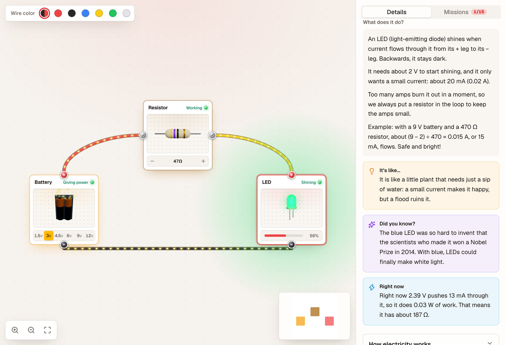</a>
      <h3>📖 درس‌ها</h3>
      روی هر قطعه بزن تا با زبان ساده بفهمی چه کار می‌کند، با یک «مثل…»، یک «می‌دانستی؟» و بخش «همین الان» که با عددهای زندهٔ میز کار توضیح می‌دهد. مقاومت‌ها خواندن رنگ‌ها را هم یاد می‌دهند.
    </td>
    <td width="50%" valign="top">
      <a href="docs/images/missions.jpg">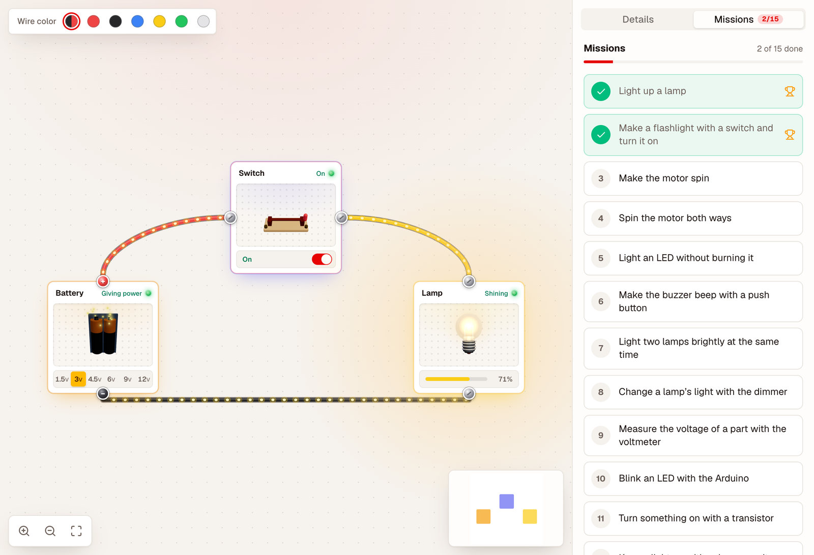</a>
      <h3>🏆 ماموریت‌ها</h3>
      پانزده چالش، از «یک لامپ روشن کن» تا «با آردوینو یک ال‌ای‌دی را چشمک‌زن کن». هر وقت مدار روی میز کار را درست انجام دهد، ماموریت خودش تیک می‌خورد و جشن کاغذرنگی برپا می‌شود.
    </td>
  </tr>
  <tr>
    <td width="50%" valign="top">
      <a href="docs/images/toolbox.jpg">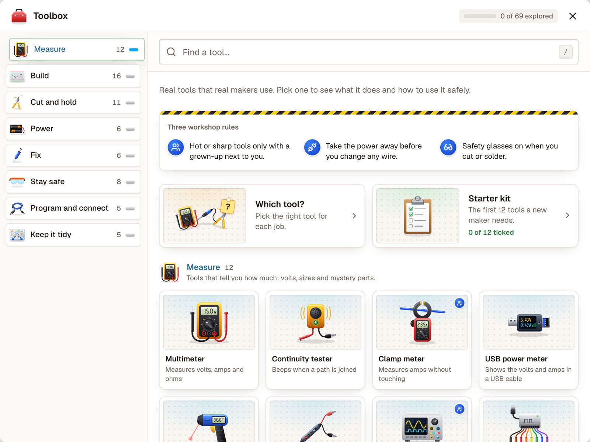</a>
      <h3>🧰 جعبه‌ابزار</h3>
      ۶۹ ابزار واقعی کارگاه در هشت دسته: اندازه‌گیری، ساختن، بریدن و گرفتن، برق‌رسانی، تعمیر، ایمنی، برنامه‌نویسی و اتصال، و مرتب نگه داشتن. به‌علاوهٔ مسابقهٔ «کدام ابزار؟» و چک‌لیست کیت شروع.
    </td>
    <td width="50%" valign="top">
      <a href="docs/images/tool.jpg">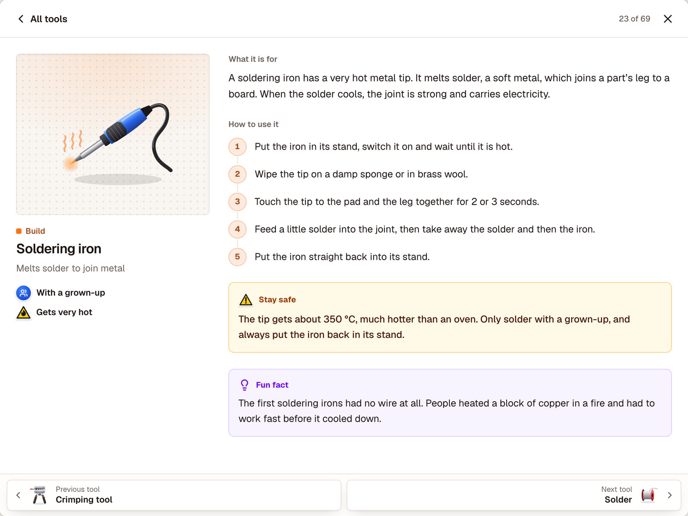</a>
      <h3>🔧 یک صفحه برای هر ابزار</h3>
      هر ابزار یک نقاشی دارد، می‌گوید کارش چیست، قدم‌به‌قدم طرز استفاده‌اش را یاد می‌دهد، نکتهٔ ایمنی و یک دانستنی جالب دارد. اگر قطعهٔ مشابهش روی میز باشد، با یک دکمه امتحانش می‌کنی.
    </td>
  </tr>
</table>

<details>
<summary><b>همه چیز داخل برنامه</b> (همهٔ قطعه‌ها، بردها و قفسه‌های نمونه)</summary>

- **منبع انرژی:** باتری از ۱٫۵ تا ۱۲ ولت، پنل خورشیدی، منبع تغذیه، باتری لیمویی (سه لیمو یک ال‌ای‌دی قرمز را کم‌نور روشن می‌کند)، باتری سکه‌ای، دینام دستی و پاوربانک.
- **بردها:** آردوینو اونو، نانو و مگا، ESP32، ESP8266، رزبری پای پیکو، میکروبیت، رزبری پای، تراشه‌های AVR یعنی ATmega328P، ATmega32 (ATmega16) و ATtiny85 با کد AVR C در سطح رجیستر، و STM32 بلوپیل. هر پایه می‌تواند روشن، خاموش، چشمک‌زن، نوبتی، کم‌وزیادشونده یا دنبال‌کنندهٔ یک سنسور باشد، و برد کد واقعیِ همان انتخاب را نشان می‌دهد.
- **بردهای دنیای واقعی:** کامپیوتر موتور خودرو (ECU)، PLC کارخانه که برنامه‌اش را به زبان Structured Text نشان می‌دهد و RTU چاه نفت، به‌علاوهٔ یک فشارسنج صنعتی.
- **پیام و شبکه:** ماژول‌های پیامک، وای‌فای، بلوتوث و LoRa، یک GPS، و CAN باس خودرو و RS-485 / مادباس کارخانه.
- **برد هوش مصنوعی:** بردی که با آن حرف می‌زنی: «چراغ قرمز را چشمک‌زن کن»، «وقتی هوا تاریک شد لامپ را روشن کن».
- **کلیدها و ولوم‌ها:** کلید، شستی، کلید راه‌پله، میکروسوییچ، دیمر، ولوم (پتانسیومتر)، جوی‌استیک و رله.
- **قطعات الکترونیکی:** مقاومت (با درس خواندن رنگ‌ها)، خازن، دیود، دیود زنر، ترانزیستورها، ماسفت، اپتوکوپلر، فیوز و رگولاتور ولتاژ.
- **تراشه‌ها و منطق:** گیت‌های NOT، AND، OR، XOR، NAND و NOR با جدول درستی زنده، حافظهٔ لچ، شمارندهٔ چراغ‌های دنبال‌هم، مقایسه‌گر، چشمک‌زن ۵۵۵ و درایور موتور.
- **نور، صدا و حرکت:** لامپ، ال‌ای‌دی، ال‌ای‌دی RGB، موتور، موتور ویبره، بازر (بیپ یا آژیر واقعی پلیس)، بلندگو، زنگ برقی، المنت حرارتی، آهنربای الکتریکی، سلونوئید، سروو، لیزر، ال‌ای‌دی مادون قرمز، چراغ راهنمایی، چراغ گردان هشدار، نوار ال‌ای‌دی، فن و پمپ آب با آبی که واقعاً جریان دارد.
- **سنسورها:** نور، دما، شیب، آهنربا، فاصله، حرکت، صدا، دود، خاک، لمس، شعله، باران، سطح آب، رطوبت، مانع، خط، فشار، ضربان قلب و ضربه.
- **نمایشگرها:** نمایشگر عددی، صفحه‌های متنی و رنگی، ماتریس ال‌ای‌دی و دیوارهای ال‌ای‌دی در هر اندازه.
- **وسایل اندازه‌گیری:** مولتی‌متر، لاجیک‌پروب، ولت‌متر، آمپرمتر و اسیلوسکوپ.
- **اشتباه‌های بی‌خطر:** ولتاژ زیاد لامپ را می‌سوزاند، ال‌ای‌دی بدون مقاومت می‌سوزد، سیمی که دو سر باتری را مستقیم به هم وصل کند اتصال کوتاه درست می‌کند، و فیوز می‌سوزد تا بقیهٔ مدار سالم بماند. هیچ چیز واقعاً خراب یا داغ نمی‌شود، پس بچه‌ها می‌توانند هر چیزی را امتحان کنند، اشتباه کنند و بفهمند چرا.
- **۲۱۳ پروژهٔ نمونه** در هفده قفسه، از جمله ۲۱ پروژهٔ خودرو، ۲۱ پروژهٔ کارخانه، ۱۲ پروژهٔ نفت و گاز، ۲۵ وسیلهٔ خانگی که نشان می‌دهند از درون چطور کار می‌کنند (لباسشویی، یخچال، جارو برقی، آب‌میوه‌گیری، همزن، توستر، اتو، سماور …) و ۱۱ پروژه که با آن‌ها حرف می‌زنی، با جستجو و فیلتر آسان / متوسط / سخت.

</details>

## سه زبان، تک‌تک کلمه‌ها

آزمایشگاه مدار از پایه به **فارسی، عربی و انگلیسی** ساخته شده است؛ کودکی در تهران، مسقط یا لندن همان برنامه را به زبان خودش می‌بیند.

- **همه چیز به هر سه زبان:** میز کار، هر ۱۱۱ قطعه و درس‌هایشان، ۲۱۳ پروژهٔ نمونه، ۱۵ ماموریت، جعبه‌ابزار و مسابقه‌اش، و همهٔ نکته‌ها و هشدارها.
- **راست‌به‌چپ واقعی:** در فارسی و عربی کل برنامه آینه می‌شود، از پنل‌ها و منوها تا اسلایدرها و کلیدهای جهت‌نما، و فرمول‌هایی مثل V = A × Ω باز هم درست خوانده می‌شوند.
- **فونتی مخصوص هر خط،** و اعداد فارسی همان‌جا که بچه‌های فارسی‌زبان انتظارش را دارند.
- **جستجویی که حرفت را می‌فهمد:** شکل عربی و فارسی یک حرف (ي / ی، ك / ک) به همان نتیجه می‌رسند.
- **هوش مصنوعی‌ای که زبانت را بلد است:** برد هوش مصنوعی درخواست را به هر سه زبان می‌فهمد و به زبان برنامه جواب می‌دهد.

## حرف زدن با برد هوش مصنوعی

برد هوش مصنوعی از یک مدل زبانی استفاده می‌کند که با [Ollama](https://ollama.com) روی کامپیوتر خودتان اجرا می‌شود. بدون حساب کاربری و بدون فضای ابری: حرف‌های کودک در خانه می‌ماند.

1. Ollama را از [ollama.com](https://ollama.com) نصب و باز کنید.
2. یک بار یک مدل دانلود کنید، مثلاً `ollama pull gemma3:4b`.
3. در آزمایشگاه مدار یک برد هوش مصنوعی اضافه کنید (یا یک نمونه از قفسهٔ **هوش مصنوعی** را باز کنید) و روی کارتش **بپرس** را بزنید.

اگر چیزی کم باشد، پنل هوش مصنوعی قدم‌های ساده‌ای برای درست کردنش نشان می‌دهد.

## همه‌جا همراه شما

- **آنلاین** در [circuitlab.app](https://circuitlab.app)، روی کامپیوتر، تبلت یا گوشی.
- **نصب مثل یک برنامه** از منوی مرورگر (گزینهٔ «نصب» یا «افزودن به صفحهٔ اصلی»).
- **کار بدون اینترنت** بعد از اولین بازدید؛ میز کار هم خودکار ذخیره می‌شود.

## اجرا روی کامپیوتر خودتان

به [Node.js](https://nodejs.org) نسخهٔ ۲۲٫۱۲ یا بالاتر نیاز دارید.

</div>

```bash
git clone https://github.com/circuitlab-app/circuitlab.git
cd circuitlab
npm install
npm run dev      # http://localhost:5173
```

<div dir="rtl">

| دستور | چه کار می‌کند |
| --- | --- |
| `npm run dev` | برنامه را با بارگذاری خودکار تغییرات اجرا می‌کند |
| `npm test` | تست‌های واحد را اجرا می‌کند (Vitest) |
| `npm run lint` | کد را با oxlint بررسی می‌کند |
| `npm run build` | نوع‌ها را بررسی و سایت را در `dist/` می‌سازد |

ساخته‌شده با React 19، TypeScript، Vite، React Flow، three.js (React Three Fiber)، Tailwind CSS، shadcn/ui و Zustand. حل‌کنندهٔ مدار یک موتور کوچک تحلیل گره‌ای در `src/circuit/solver.ts` است. [docs/DEVELOPMENT.md](docs/DEVELOPMENT.md) (به انگلیسی) توضیح می‌دهد شبیه‌سازی، مدل‌های سه‌بعدی و برد هوش مصنوعی چطور کار می‌کنند.

## مشارکت

ایده، گزارش اشکال و درخواست ادغام (Pull Request) با کمال میل پذیرفته می‌شود.

- **اشکالی پیدا کردید یا ایده‌ای دارید؟** یک [Issue باز کنید](https://github.com/circuitlab-app/circuitlab/issues) و اگر می‌توانید عکس صفحه هم بگذارید.
- **می‌خواهید چیزی اضافه کنید؟** بخش [Adding things](docs/DEVELOPMENT.md#adding-things) قدم‌های اضافه کردن یک قطعه یا یک زبان تازه را نشان می‌دهد. پروژه‌های نمونه در `src/circuit/presets.ts` هستند.
- **پیش از درخواست ادغام** دستورهای `npm test`، `npm run lint` و `npm run build` را اجرا کنید و کلمه‌های تازه را به هر سه دیکشنری در `src/i18n/` (انگلیسی، فارسی و عربی) اضافه کنید.

اگر آزمایشگاه مدار به کودکی که می‌شناسید کمک کرده، یک ⭐ در گیت‌هاب کمک می‌کند دیگران هم پیدایش کنند.

## دربارهٔ ما

آزمایشگاه مدار محصولی از **SBC** است · [sbc.om](https://sbc.om) · منتشرشده با [مجوز MIT](LICENSE).

</div>
